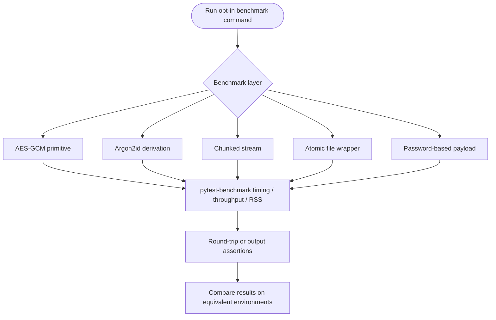

# Benchmarks

Performance tests are deliberately excluded from the default test run. Enable
them explicitly from the repository root:

```console
pytest -o addopts= -m benchmark tests/benchmarks
```

To produce pytest-benchmark's report and save results for later comparison:

```console
pytest -o addopts= -m benchmark tests/benchmarks --benchmark-columns=min,mean,median,max
pytest -o addopts= -m benchmark tests/benchmarks --benchmark-save=baseline
pytest -o addopts= -m benchmark tests/benchmarks --benchmark-compare=baseline
```

Benchmark outcomes depend on CPU, operating system, Python and cryptography
versions, memory pressure, and background load. Compare results only on
comparable machines and conditions. These tests check that operations complete
and round-trip correctly; they do not set portable performance thresholds.
The AES memory tests measure process RSS before and after an operation, which
is a coarse process-level estimate rather than an allocation profiler.

## Coverage

| Benchmark module | Operation and inputs |
| --- | --- |
| `test_aes_cypher_benchmark.py` | AES-GCM encrypt/decrypt, 1 KiB–10 MiB; throughput and RSS checks |
| `test_key_derivator_benchmark.py` | Argon2id memory, time, and parallelism settings; repeated derivation |
| `test_stream_crypto_benchmark.py` | Stream round trips for empty, 64 KiB, and 1 MiB payloads |
| `test_file_cipher_benchmark.py` | File encryption for empty, 64 KiB, and 1 MiB files |
| `test_encryption_orchestrator_benchmark.py` | Password-based full encryption/decryption for 1 KiB and 1 MiB payloads |

## Measurement paths



The orchestrator and Argon2id benchmarks use reduced costs in selected cases
to keep repeated measurements practical. They are comparative performance
checks, not recommendations for production KDF settings.
