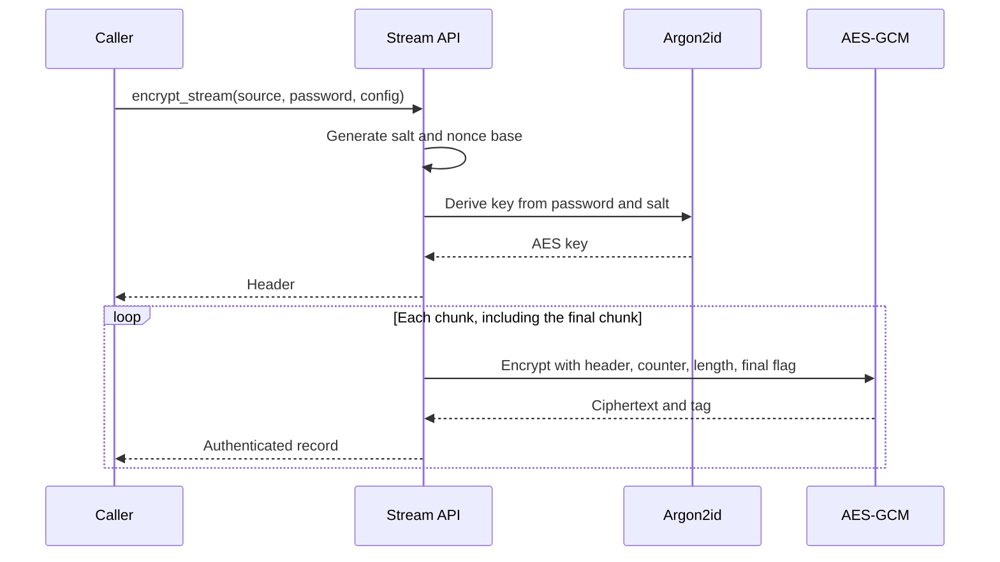

# Encrypted stream format

The stream/file format begins with a fixed-size header followed by independently
authenticated AES-GCM records. Its format identifier is `CRP1`.
Multi-byte integers are encoded in big-endian order.

## In-memory format

`EncryptionOrchestrator` returns a mapping with `version: 1`, algorithm
identifier `AES-GCM`, and an `Argon2id` object containing the derived key
length, memory cost, time cost, and parallelism. It also identifies UTF-8 and
NFC password normalization. The `salt`, `nonce`, and `ciphertext` values are
Base64 strings. The version and metadata are serialized canonically and
authenticated as AES-GCM associated data; Argon2id parameters are recorded so
future releases can retain the ability to decrypt records created with older
settings. Decryption bounds the recorded costs by the local KDF resource
limits.

In-memory format version 1 and binary stream/file format `CRP1` normalize
string passwords to NFC before UTF-8 encoding. APIs that accept `bytes`
passwords keep treating them as raw bytes; bytes are not decoded or
normalised. `KeyDerivator.derive()` accepts bytes only, which must already be
prepared by the calling API. Decryption never tries alternate password
representations.
The decoded salt must be exactly 16 bytes, the nonce exactly 12 bytes, and the
ciphertext at least 16 bytes for the AES-GCM authentication tag. Decryption
rejects components with other lengths before deriving a key. Only this
versioned mapping is accepted. This format is separate from the binary
stream/file format specified below.

## Password preparation by format version

| Format | String password bytes passed to Argon2id |
| --- | --- |
| In-memory, version 1 | Unicode NFC normalization, then UTF-8 encoding |
| Binary stream/file, `CRP1` | Unicode NFC normalization, then UTF-8 encoding |

The stream/file format has one version: `CRP1`. Password normalization does
not change the header or record structure.

## Header

| Field | Encoding | Purpose |
| --- | --- | --- |
| Magic/version | 4 bytes | Identifies the supported format |
| Salt | 16 bytes | Random Argon2id salt |
| Time cost | 4-byte unsigned integer | Argon2id iteration count |
| Memory cost | 4-byte unsigned integer | Argon2id memory in KiB |
| Parallelism | 4-byte unsigned integer | Argon2id lane count |
| Chunk size | 4-byte unsigned integer | Maximum plaintext bytes per record |
| Nonce base | 4 bytes | Random prefix for record nonces |

Encryption uses the explicit `Crypto.KDF_PROFILE`, which defaults to
`production`. That profile requires at least 64 MiB, 3 iterations, and 4 lanes;
and caps costs at 256 MiB, 5 iterations, and 16 lanes by default. Low-cost test
settings must opt into `KDFProfile.TEST`. During decryption, the header is
checked before key derivation against the production minimums and
`Crypto.MAX_TIME_COST`, `MAX_MEMORY_COST`, and `MAX_PARALLELISM`. Weak-cost
files are accepted only when the caller explicitly configures
`KDFProfile.TEST`; the profile still enforces the same upper resource bounds.
The limits cap memory at 256 MiB and iterations at 5, reducing attacker-chosen
work. Argon2id runs synchronously, so the iteration ceiling bounds work but
cannot promise a fixed wall-clock duration across different hardware.

All key derivations in one process share a single admission slot. A call that
cannot acquire the slot within one second fails with `KDFBusyError` instead of
starting another memory-hard operation. This limits simultaneous Argon2id
memory use; deployments with multiple worker processes should apply an
equivalent process-wide concurrency limit.

## Records

Each record contains AES-GCM ciphertext followed by a 16-byte authentication
tag. For record number `counter`, the 12-byte nonce is the 4-byte nonce base
followed by the 8-byte big-endian counter. All record integers use big-endian
encoding.

Each record's AES-GCM associated data is the concatenation of:

1. The 12-byte domain separator `CRP1-RECORD\0`.
2. The exact 40 header bytes as serialized on disk, including magic, salt,
   Argon2id parameters, chunk size, and nonce base.
3. The 13-byte record metadata: an 8-byte unsigned counter, a one-byte final
   record flag (`0x00` or `0x01`), and a 4-byte unsigned plaintext length.

The header is not normalized or re-serialized for AAD; its canonical
representation is its fixed-width wire encoding. Thus every record is bound to
all header fields as well as its own position, length, and finality.

Encryption reads one chunk ahead so it can mark the last record. Empty inputs
still produce one authenticated empty record. Decryption also reads one record
ahead to determine which record should carry the final marker; consuming the
iterator fully is therefore required to detect a missing end of stream.

## Configuration

The structural sizes are fixed: the module-level `SALT_SIZE`, `NONCE_BASE_SIZE`,
and `TAG_SIZE` constants define the 16-byte salt, 4-byte nonce base, and
16-byte authentication tag. They are not per-operation settings. `Crypto`
contains the magic identifier, configurable chunk size (64 KiB by default),
Argon2id costs, and resource limits. Its `MAX_*` fields are upper bounds used
when parsing an untrusted header; keep those limits appropriate for the memory
and availability constraints of the application. `MAX_CHUNK_SIZE` may be
lowered per configuration, but cannot exceed the independent
`ABSOLUTE_MAX_CHUNK_SIZE` limit (1 MiB).
