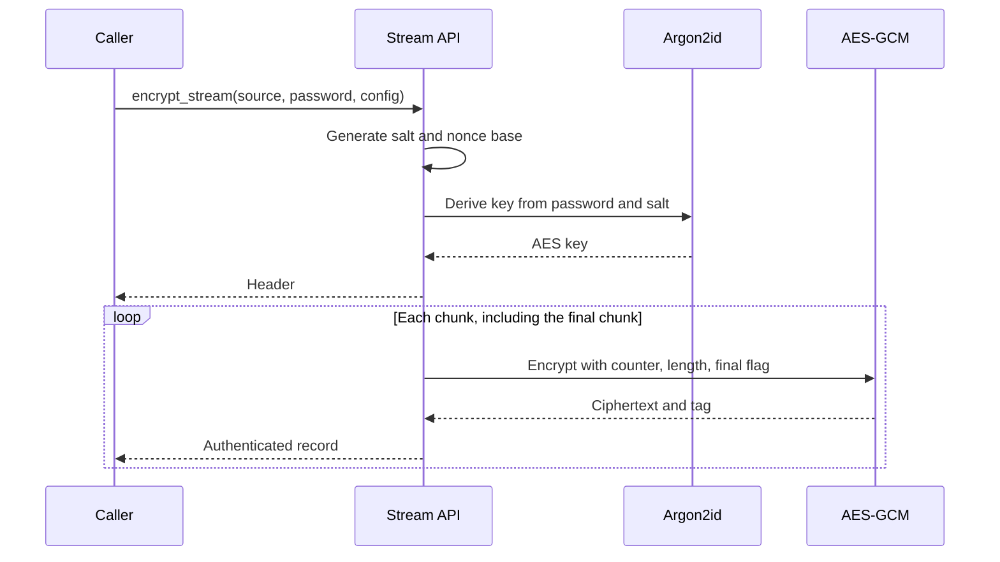

# Encrypted stream format

The stream/file format begins with a fixed-size header followed by independently
authenticated AES-GCM records. The magic value is `CRP1` in the default
configuration. Multi-byte integers are encoded in big-endian order.

## Header

| Field | Encoding | Purpose |
| --- | --- | --- |
| Magic/version | 4 bytes | Identifies the supported format |
| Salt | 16 bytes | Random Argon2id salt |
| Time cost | 4-byte unsigned integer | Argon2id iteration count |
| Memory cost | 4-byte unsigned integer | Argon2id memory in KiB |
| Parallelism | 4-byte unsigned integer | Argon2id lane count |
| Chunk size | 4-byte unsigned integer | Maximum plaintext bytes per record |
| Nonce base | 4 bytes | Random prefix for record nonces |

The implementation checks KDF parameters and the chunk size against
`Crypto`'s configured limits before deriving a key. This limits attacker-chosen
resource use during decryption.

## Records

Each record contains AES-GCM ciphertext followed by a 16-byte authentication
tag. For record number `counter`, the 12-byte nonce is the 4-byte nonce base
followed by the 8-byte big-endian counter. The associated authenticated data is
the counter, a one-byte final-record flag, and the record's plaintext length.
These authenticated metadata fields detect record reordering, truncation, and
length/final-marker changes.

Encryption reads one chunk ahead so it can mark the last record. Empty inputs
still produce one authenticated empty record. Decryption also reads one record
ahead to determine which record should carry the final marker; consuming the
iterator fully is therefore required to detect a missing end of stream.

## Configuration

`Crypto` contains the format constants, default chunk size (64 KiB), and
default Argon2id costs. Its `MAX_*` fields are upper bounds used when parsing
an untrusted header. Keep those limits appropriate for the memory and
availability constraints of the application.
