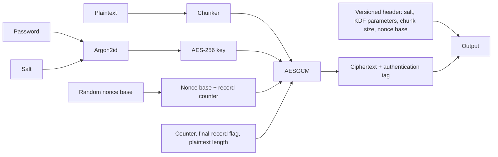

# Encryption workflows

## In-memory payloads

Use `EncryptionOrchestrator` when the full plaintext is already a `bytes`
object. Its result is a dictionary of Base64 strings that can be serialized by
an application. It generates a random salt and nonce and derives an AES key
with the configured `KeyDerivator`.

```python
from crypto.aes_cipher import AESCipher
from crypto.encryption_orchestrator import EncryptionOrchestrator
from crypto.key_derivator import KeyDerivator

crypto = EncryptionOrchestrator(KeyDerivator(), AESCipher())
record = crypto.encrypt("passphrase", b"small payload")
plaintext = crypto.decrypt("passphrase", record)
```

This representation is not the on-disk stream format: use the streaming APIs
for large inputs and files.

## Streaming data

`encrypt_stream` and `decrypt_stream` accept readable binary streams and return
iterators of byte chunks. The caller owns and closes the streams. Always
consume the full decryption iterator: authentication and truncation checks are
performed record by record, and an incomplete final stream is only detected
when the iterator reaches its end.

```python
import io

from crypto.stream_crypto import decrypt_stream, encrypt_stream

encrypted = b"".join(encrypt_stream(io.BytesIO(b"payload"), "passphrase"))
plaintext = b"".join(decrypt_stream(io.BytesIO(encrypted), "passphrase"))
```

For large streams, write each yielded chunk to a destination rather than
joining all chunks in memory.

## Files

`encrypt_file` and `decrypt_file` are wrappers around the streaming API. They:

- accept a source path and an optional existing destination **directory**;
- use `files.dest_path` from `config.py` when no destination argument is
  provided, falling back to the source directory when that setting is `None`;
- choose a numbered output filename rather than overwrite an existing file;
- stage results in a temporary file in the destination directory;
- publish the completed output only after encryption/decryption finishes.

Set the project-wide default by changing the existing mutable settings object
in `config.py`, for example `files.dest_path = Path("output")`. An explicit
`dest_path` argument overrides that setting for one call. Any selected
destination must identify an existing directory.

If decryption fails, no partially decrypted destination is published. File
names use `_encrypted` and `_decrypted` suffixes.

## Data flow



## Error handling

Catch the package's `CryptoError` base class when an application wants to handle
expected crypto failures uniformly. More specific subclasses distinguish
invalid input (`ValidationError`), malformed headers (`HeaderError`), failed
authentication (`IntegrityError`), unsupported format versions
(`UnsupportedVersionError`), and incomplete streams (`TruncatedStreamError`).
File and stream I/O failures use `CryptoFileError`.
